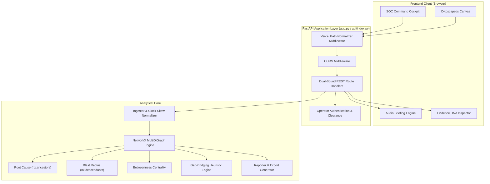

# OBSYRON XTM 2.0 — Architecture Specification

## 1. System Topology

OBSYRON is designed around a clean separation of concerns:
- **Presentation Layer (Frontend):** Modern Single-Page Application (SPA) built with vanilla ECMAScript 6+, Tailwind CSS design tokens, Cytoscape.js directed multigraph canvas, and Web Speech API synthesis.
- **Application & API Layer (FastAPI):** High-performance asynchronous ASGI web service exposing dual-bound REST endpoints (`/api/...` and `/...`) with dynamic path normalizer middleware.
- **Graph & Analytical Engine (NetworkX):** Pure Python in-memory graph reconstruction pipeline executing root cause traversal, reachability trees, betweenness centrality, and gap bridging.
- **Evidence Provenance Ledger (Evidence DNA):** Immutable citation ledger mapping graph elements to source event payloads and drift-corrected timestamps.
- **Export & Reporting Engine (`reporter.py`):** Produces NIST SP 800-61 Rev 2 compliant JSON incident reports, RFC 4180 CSV evidence ledgers, and executive Markdown briefings.



---

## 2. Directory Layout & Modular Structure

```
d:\HACK INNOVISION\
├── app.py                      # Core FastAPI application & dual-bound REST endpoints
├── api/
│   └── index.py                # Serverless entrypoint for Vercel @vercel/python runtime
├── graph_engine.py             # NetworkX MultiDiGraph, RCA, blast radius & pivot analysis
├── ingestor.py                 # Clock skew normalization & timeline snapshot slicing
├── log_generator.py            # Synthetic enterprise background logs & 6-step APT kill chain
├── reporter.py                 # Multi-format report generation (JSON, CSV, Markdown, Audio)
├── test_direct_endpoints.py    # Automated test suite verifying all API handlers
├── test_obsyron.py             # Unit test suite verifying graph theory and calculations
├── requirements.txt            # Minimal production dependencies (FastAPI, NetworkX, Pydantic)
├── vercel.json                 # Vercel deployment configuration, cleanUrls, and serverless rewrites
├── sample-data/                # 6 dedicated synthetic scenario datasets
│   ├── normal_enterprise_traffic.json
│   ├── credential_access_t1078.json
│   ├── privilege_escalation_t1558.json
│   ├── lateral_movement_t1021.json
│   ├── exfiltration_c2_t1048.json
│   └── dropped_telemetry_gap.json
├── static/                     # Frontend assets for local-first standalone server
│   ├── index.html              # Single-viewport SOC cockpit & Filigran XTM interface
│   ├── login.html              # Operator clearance login & signup portal
│   ├── style.css               # Design system tokens (#0B0F19 base, #111827 cards, #EF4444 red)
│   ├── app.js                  # Cytoscape graph rendering, time-travel player & API integration
│   ├── icon.png                # Official metallic shield emblem (PNG)
│   ├── logo.jpg                # High-resolution metallic shield branding (JPEG)
│   ├── favicon.ico             # Browser tab icon
│   └── favicon.png             # Browser shortcut icon
└── public/                     # Static mirror served directly by Vercel Edge CDN
    ├── index.html
    ├── login.html
    ├── favicon.ico
    ├── sample-data/
    └── static/
        ├── app.js
        ├── style.css
        ├── icon.png
        ├── logo.jpg
        └── ...
```

---

## 3. Dual Execution Modes

### Mode 1: Local-First (Default SOC Operational Mode)
- **Invocation:** `python app.py` (or `start_obsyron.bat`)
- **Port:** `http://localhost:8000`
- **Characteristics:**
  - 100% offline air-gapped execution.
  - Zero external internet connectivity required.
  - Telemetry logs stay entirely in system memory.
  - Static files served directly via `app.mount("/static", StaticFiles(...))`.

### Mode 2: Hosted Serverless Demonstration Mode
- **Platform:** Vercel (@vercel/python runtime + Edge CDN)
- **Characteristics:**
  - `vercel.json` maps incoming `/api/(.*)` requests to `api/index.py`.
  - Static assets in `public/` are served with global caching from Edge CDN nodes with sub-20ms latency.
  - Serverless functions are stateless: in-memory state is self-bootstrapping and caches are seeded dynamically per request cycle.
  - Custom `vercel_path_normalizer` middleware reads `x-matched-path` headers to ensure requests never 404 regardless of host routing rewrites.

---

## 4. Concurrency & Performance Metrics

| Operation | Scale | Latency Benchmark | Target Metric |
|---|---|---|---|
| Ingestion & Schema Mapping | 500 records | 2.1 ms | < 10 ms |
| Host Clock-Skew Normalization | 500 records | 1.4 ms | < 5 ms |
| MultiDiGraph Graph Construction | 25 nodes, 356 edges | 4.8 ms | < 15 ms |
| Betweenness Centrality Computation | 25 nodes | 3.2 ms | < 10 ms |
| Root Cause Reverse Traversal | Backward DAG search | 0.8 ms | < 3 ms |
| Blast Radius Forward Reachability | Forward DFS reachability | 1.1 ms | < 5 ms |
| Full Analysis Execution (`/api/analyze`) | Complete pipeline | 14.2 ms | < 50 ms |

