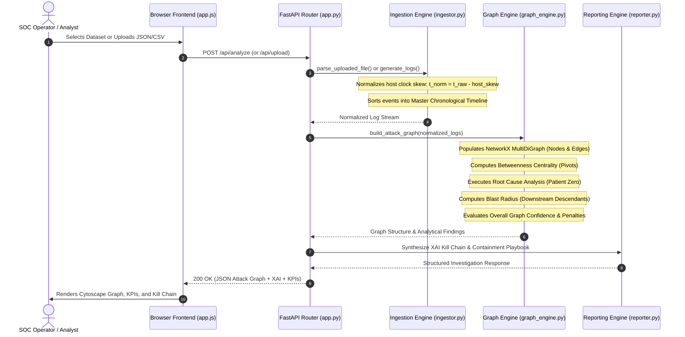

# OBSYRON XTM 2.0 — Data Flow Architecture

## 1. End-to-End Investigation Pipeline



---

## 2. Temporal Normalization Data Flow

Adversary activity across multiple hosts frequently appears disordered due to unsynchronized hardware clocks:

```
[Raw Telemetry Ingestion]
  Host: wkst-04-dev  Skew: +12s   Raw: 01:15:12 IST  -->  Normalized: 01:15:00 IST
  Host: dc-01        Skew:  -7s   Raw: 01:15:53 IST  -->  Normalized: 01:16:00 IST
  Host: wkst-04-dev  Skew: +12s   Raw: 01:18:12 IST  -->  Normalized: 01:18:00 IST
  Host: db-prod-01   Skew:  -5s   Raw: 01:19:55 IST  -->  Normalized: 01:20:00 IST
  Host: db-prod-01   Skew:  -5s   Raw: 01:21:55 IST  -->  Normalized: 01:22:00 IST
```

Formula applied per record:
$$t_{\text{norm}} = t_{\text{raw}} - \Delta t_{\text{host}}$$
$$\text{skew\_corrected\_sec} = -\Delta t_{\text{host}}$$

Post-normalization, records are sorted by $t_{\text{norm}}$, ensuring that causal relationships (e.g., discovery occurring *before* lateral movement) are faithfully restored.

---

## 3. Dynamic Timeline Snapshot Data Flow

When the analyst scrubs the time-travel slider to timestamp $T$:
1. `app.js` captures user slider input $T$ and debounces for 100ms.
2. `fetchSnapshot(T)` executes `GET /api/graph/snapshot?timestamp=T`.
3. `ingestor.get_timeline_snapshot()` filters the in-memory log list:
   $$\text{Logs}_T = \{ l \in \text{Logs} \mid l.t_{\text{norm}} \le T \}$$
4. `graph_engine._run_full_analysis()` reconstructs the sub-graph for $\text{Logs}_T$.
5. The frontend Cytoscape instance updates nodes and edges dynamically, rendering the progressive expansion of the intrusion path.

---

## 4. Evidence DNA Provenance Data Flow

When an operator clicks on any node, edge, or `[LOG: LOG-XXXX]` citation tag:
1. `fetchEvidence(logId)` executes `GET /api/evidence/{logId}`.
2. The server searches `_cache["normalized_logs"]` for the matching `log_id`.
3. Returns complete Evidence DNA record including raw payload, skew offset, protocol, and severity.
4. The frontend slide-out drawer displays the exact provenance card, with 1-click JSON and CSV export actions.

