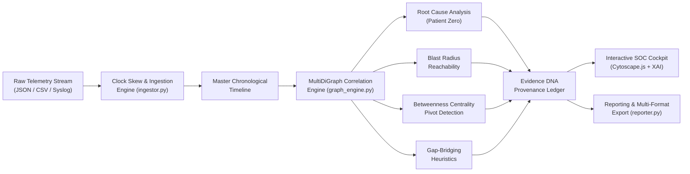

# OBSYRON XTM 2.0 — Project Overview

> **Autonomous Threat Management & Forensic Attack Graph Reconstruction**  
> *Event:* HackInnovision 2026, NIT Rourkela  
> *Track:* Track C — Cyber Investigation & Attack Graph Reconstruction (Project CHIMERA)  
> *Theme:* Evidence-Driven Cyber Reasoning, Temporal Anomaly Detection & Explainable AI  
> *Repository:* [Suswapnil05/OBSYRON](https://github.com/Suswapnil05/OBSYRON)  
> *Live Deployment:* [https://obsyron.vercel.app/](https://obsyron.vercel.app/)

---

## 1. Executive Summary

Modern Security Operations Centers (SOCs) face an overwhelming volume of disconnected telemetry. Over 98% of security log alerts represent routine enterprise background activity, while genuine Advanced Persistent Threat (APT) campaigns execute slowly and stealthily across distributed identities, endpoints, and microservices. Furthermore, forensic analysts are routinely hampered by:
1. **Clock Skew:** Asynchronous Network Time Protocol (NTP) drifts across domain controllers, developer workstations, and database clusters distort event causality.
2. **Out-of-Order Packet Arrival:** Network buffering and distributed collectors cause logs to arrive out of chronological order.
3. **Fragmented Audit Telemetry:** Savvy adversaries clear event logs, terminate audit services, or leverage alternative egress protocols to create telemetry blind spots.
4. **AI Hallucination:** Black-box LLM dashboards fabricate speculative attack steps without linking conclusions to verifiable raw log citations.

**OBSYRON XTM 2.0** is an open-source, defensive forensic investigation platform built to solve these challenges. Operating 100% offline and locally (with zero external cloud dependencies) as well as seamlessly in serverless Edge environments, OBSYRON normalizes multi-host telemetry streams, reconstructs temporal causality using a directed multigraph (`NetworkX.MultiDiGraph`), isolates initial access ("Patient Zero"), quantifies downstream blast radius, bridges missing telemetry with penalized confidence heuristics, and provides explainable AI narratives anchored to immutable **Evidence DNA** log records.

---

## 2. Core Missions & Objectives

| Objective | Description | Technical Implementation |
|---|---|---|
| **Multi-Source Ingestion** | Ingest enterprise authentication, endpoint execution, directory queries, and network egress telemetry in JSON and CSV schemas. | `ingestor.py` with multi-schema key mapping |
| **Clock-Skew Normalization** | Eliminate relative clock drift ($\Delta t \in [\pm 5\text{s}, \pm 20\text{s}]$) across disparate host clocks. | $t_{\text{norm}} = t_{\text{raw}} - \Delta t_{\text{host}}$ master timeline |
| **Out-of-Order Ingestion** | Reconcile asynchronous log arrival into strict causal ordering. | ISO 8601 master sorting post-skew correction |
| **Directed Attack Multigraph** | Map multi-entity interactions (USER, DEVICE, SERVICE, EXT_IP) across multiple concurrent edges. | `networkx.MultiDiGraph` |
| **Root Cause Analysis (RCA)** | Identify Patient Zero and initial compromise vector using reverse graph traversal. | `nx.ancestors()` traversal & in-degree analysis |
| **Blast Radius Quantification** | Determine forward reachability, identifying compromised identities, pivot machines, and exposed data stores. | `nx.descendants()` & shortest-path tree |
| **Pivot Node Discovery** | Pinpoint critical bridge assets leveraged by the adversary to pivot laterally between network segments. | Brandes' Betweenness Centrality algorithm |
| **Gap-Bridging Uncertainty** | Heuristically infer missing kill chain links caused by log evasion, penalizing confidence scores appropriately. | Temporal and entity proximity bridging |
| **Explainable AI (XAI)** | Generate human-readable investigative narratives where every sentence links to verified log IDs. | Evidence DNA Provenance Ledger |
| **Time-Travel Scrubber** | Replay the incident chronologically from initial ingress to data exfiltration. | Dynamic timeline slicing API & Cytoscape.js |
| **Executive Audio Debrief** | Deliver hands-free spoken voice intelligence briefs to incident commanders. | Web Speech API & Neural TTS script synthesis |
| **NIST 800-61 Compliance** | Export audit reports, CSV evidence tables, and containment playbooks. | `reporter.py` multi-format export engine |

---

## 3. Platform Architecture at a Glance

---

## 4. Key Differentiators

1. **Zero Hallucination Guarantee:** OBSYRON never synthesizes an attack stage without citing exact raw log IDs (`LOG-APT-001`, `LOG-APT-004`, etc.) or explicitly flagging it as an `INFERRED_LATERAL_BRIDGE` with mathematical confidence penalty.
2. **Defensive-Only Scope:** Strictly designed for threat containment, retrospective incident analysis, and simulated tabletop scenarios. Contains no offensive exploit automation or weaponized code.
3. **Dual Execution Architecture:**
   - **Local-First:** Runs 100% locally via `python app.py` on `http://localhost:8000`, ensuring classified enterprise logs never leave the internal network.
   - **Cloud Serverless:** Fully compatible with Vercel Serverless Functions (`api/index.py`) and Edge CDN delivery (`public/`), requiring no persistent cloud database.
4. **NIST SP 800-61 Rev 2 Alignment:** Reconstructed incidents map directly to Incident Handling steps (Preparation, Detection & Analysis, Containment, Eradication & Recovery, Post-Incident Activity).
