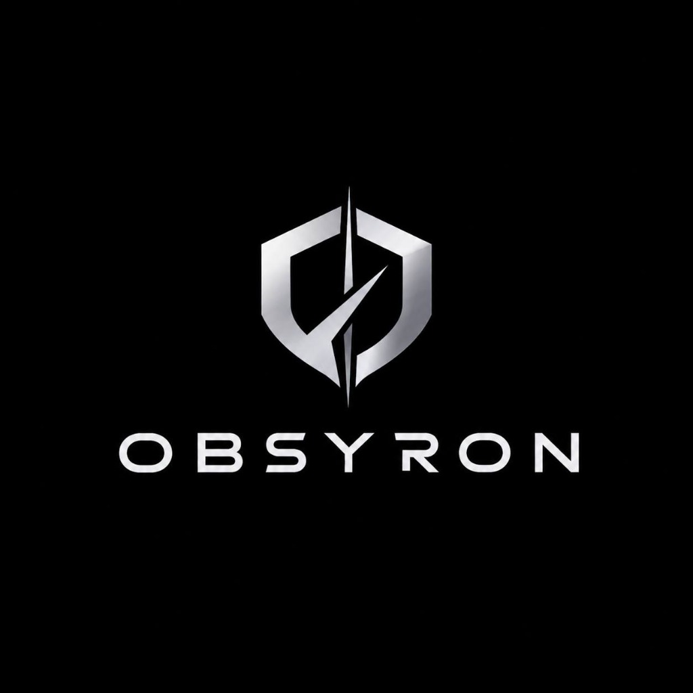

<div align="center">
  
  <h1>OBSYRON XTM 2.0</h1>
  <p><strong>Autonomous Cyber Forensic Investigation &amp; Dynamic Attack Graph Reconstruction</strong></p>
  <p><em>HackInnovision 2026 (NIT Rourkela) — Track C: CHIMERA</em></p>
  <p>
    <a href="https://obsyron.vercel.app/"></a>
    
    
    
    
    
  </p>
</div>

---

**Execution Mode:** 100% Standalone Air-Gapped Localhost Application + Vercel Serverless Edge CDN  
**Live Production URL:** [https://obsyron.vercel.app/](https://obsyron.vercel.app/)  
**GitHub Repository:** [Suswapnil05/OBSYRON](https://github.com/Suswapnil05/OBSYRON)  

---

## 1. Executive Summary & Incident Scenario

Inside modern enterprise networks, advanced persistent threats (APTs) unfold silently without triggering isolated high-severity SIEM alarms:
1. **Initial Access (`T1078`):** An external adversary IP (`185.220.101.47`, TOR exit relay) authenticates off-hours to employee account `emp_rohan` on developer workstation `wkst-04-dev`.
2. **Reconnaissance (`T1087`):** The compromised identity runs Active Directory account discovery (`net user /domain`) over LDAP port 389.
3. **Privilege Escalation (`T1558`):** Service account `svc_ci_deploy` is silently granted `SeDebugPrivilege` to enable token impersonation and Kerberos ticket theft.
4. **Lateral Movement (`T1021`):** The adversary pivots laterally to production database host `db-prod-01` via SMB port 445 (`ADMIN$` share) using NTLM pass-the-hash.
5. **Data Exfiltration (`T1048`):** Production database `db-prod-01` opens an outbound TCP flow on non-standard port 4444 to `185.220.101.47`, exfiltrating 2.45 MB of database tables.
6. **Command & Control (`T1048`):** An encrypted C2 beacon with 30-second heartbeats is established from `db-prod-01` to `185.220.101.47`.

**OBSYRON** ingests noisy (~350 benign logs), delayed, out-of-order, and fragmented enterprise telemetry, reconciles host clock skews ($t_{\text{norm}} = t_{\text{raw}} - \Delta t_{\text{host}}$), reconstructs the multi-entity directed attack graph, detects compromised internal pivot hosts via betweenness centrality, isolates the initial access vector (Patient Zero), calculates downstream blast radius, bridges telemetry gaps with confidence-penalized heuristics, and grounds every forensic conclusion in immutable log citations.

---

## 2. Core Pillars & Capabilities

| Module | Forensic Capability | Implementation Detail |
|---|---|---|
| **1. Chaos Ingestor & Clock-Skew Correlator** | Re-orders shuffled logs and eliminates host clock skew ($\Delta t \in [\pm 5\text{s}, \pm 20\text{s}]$) | $t_{\text{norm}} = t_{\text{raw}} - \Delta t_{\text{host}}$ across all sources into a synchronized master timeline |
| **2. Dynamic MultiDiGraph Engine** | Models parallel interactions across the 4 core entities: **Users**, **Devices**, **Services**, and **External Endpoints** | Built using `nx.MultiDiGraph` with betweenness centrality pivot scoring |
| **3. Uncertainty & Gap-Bridging Heuristic** | Recovers disconnected attack paths when intermediate logs (e.g. privilege escalation) are dropped | Synthesizes an `INFERRED_LATERAL_BRIDGE` edge (dashed amber line) with penalized confidence (59%–61%) vs solid red edges (90%–98%) |
| **4. Root-Cause Analysis (Patient Zero)** | Backward graph traversal (`nx.ancestors` + zero in-degree root detection) | Pinpoints initial entry vector `185.220.101.47` -> `emp_rohan` at 01:15 IST |
| **5. Blast-Radius Calculator** | Forward reachability analysis (`nx.descendants` + shortest paths) | Discovers all exposed downstream assets (`emp_rohan`, `wkst-04-dev`, `svc_ci_deploy`, `db-prod-01`) and outputs a prioritized containment checklist |
| **6. Evidence DNA Inspector** | Zero-hallucination explainability | Immutable JSON provenance ledger attached to every node, edge, and XAI claim |
| **7. SOC Audio Briefing** | Offline executive voice debrief | Web Speech API synthesis summarizing the incident and response actions |
| **8. Multi-Format Report Generator** | Standards-compliant documentation | Downloads NIST SP 800-61 JSON reports, RFC 4180 CSV evidence ledgers, and Markdown briefs |
| **9. Operator Clearance Directory** | Role-based authorization | Multi-level clearance portal (`/login`) with Level 4 (Top Secret/SCI) to Level 2 (Confidential) |

---

## 3. Complete Technical Documentation Index

Every aspect of OBSYRON is thoroughly documented in dedicated specifications:

| Document | Focus & Scope |
|---|---|
| [PROJECT_OVERVIEW.md](file:///d:/HACK%20INNOVISION/docs/PROJECT_OVERVIEW.md) | High-level executive overview, problem statement, and key differentiators |
| [ARCHITECTURE.md](file:///d:/HACK%20INNOVISION/docs/ARCHITECTURE.md) | System topology, modular structure, and dual-mode execution details |
| [SYSTEM_DESIGN.md](file:///d:/HACK%20INNOVISION/docs/SYSTEM_DESIGN.md) | End-to-end component interactions, schema definitions, and air-gap security |
| [FEATURES.md](file:///d:/HACK%20INNOVISION/docs/FEATURES.md) | Exhaustive catalog of forensic capabilities, chaos controls, and UI tools |
| [TECH_STACK.md](file:///d:/HACK%20INNOVISION/docs/TECH_STACK.md) | Justifications for Python, FastAPI, NetworkX, Cytoscape.js, and dependencies |
| [DATA_FLOW.md](file:///d:/HACK%20INNOVISION/docs/DATA_FLOW.md) | Detailed sequence and data flow diagrams from ingestion to visualization |
| [API_DOCUMENTATION.md](file:///d:/HACK%20INNOVISION/docs/API_DOCUMENTATION.md) | Complete OpenAPI/REST specification for all dual-bound endpoints |
| [DATABASE_AND_STORAGE.md](file:///d:/HACK%20INNOVISION/docs/DATABASE_AND_STORAGE.md) | In-memory cache architecture, zero-external-database design, and persistence |
| [SECURITY_MODEL.md](file:///d:/HACK%20INNOVISION/docs/SECURITY_MODEL.md) | Defensive-only guardrails, air-gapped guarantees, and RBAC clearances |
| [MITRE_MAPPING.md](file:///d:/HACK%20INNOVISION/docs/MITRE_MAPPING.md) | Mapping matrix for T1078, T1087, T1558, T1021, and T1048 |
| [CONFIDENCE_SCORING.md](file:///d:/HACK%20INNOVISION/docs/CONFIDENCE_SCORING.md) | Mathematical formulas for edge and graph-level corroboration scores |
| [EVIDENCE_DNA.md](file:///d:/HACK%20INNOVISION/docs/EVIDENCE_DNA.md) | Immutable provenance ledger format and verification protocols |
| [TIMELINE_ENGINE.md](file:///d:/HACK%20INNOVISION/docs/TIMELINE_ENGINE.md) | Clock-skew compensation mathematics and dynamic snapshot slicing |
| [GRAPH_ENGINE.md](file:///d:/HACK%20INNOVISION/docs/GRAPH_ENGINE.md) | NetworkX multigraph algorithms, betweenness centrality, and Cytoscape styling |
| [GAP_BRIDGING.md](file:///d:/HACK%20INNOVISION/docs/GAP_BRIDGING.md) | Heuristic interpolation of missing telemetry steps with confidence penalties |
| [ROOT_CAUSE_ANALYSIS.md](file:///d:/HACK%20INNOVISION/docs/ROOT_CAUSE_ANALYSIS.md) | Backward reachability traversal and Patient Zero attribution logic |
| [BLAST_RADIUS_ANALYSIS.md](file:///d:/HACK%20INNOVISION/docs/BLAST_RADIUS_ANALYSIS.md) | Forward reachability algorithm, asset criticality ranking, and containment |
| [DATASET_DOCUMENTATION.md](file:///d:/HACK%20INNOVISION/docs/DATASET_DOCUMENTATION.md) | Documentation for the 6 synthetic datasets in `sample-data/` |
| [TESTING_GUIDE.md](file:///d:/HACK%20INNOVISION/docs/TESTING_GUIDE.md) | How to execute automated direct test suites and manual verification |
| [DEPLOYMENT_GUIDE.md](file:///d:/HACK%20INNOVISION/docs/DEPLOYMENT_GUIDE.md) | Deployment guides for local air-gapped workstations and Vercel Serverless |
| [LOCAL_SETUP.md](file:///d:/HACK%20INNOVISION/docs/LOCAL_SETUP.md) | 1-click startup, virtual environments, and Windows batch file usage |
| [TROUBLESHOOTING.md](file:///d:/HACK%20INNOVISION/docs/TROUBLESHOOTING.md) | Solutions for port conflicts, Vercel routing 404s, and audio policies |
| [CONTRIBUTING.md](file:///d:/HACK%20INNOVISION/docs/CONTRIBUTING.md) | Guidelines for contributing code, tests, and documentation |
| [CHANGELOG.md](file:///d:/HACK%20INNOVISION/docs/CHANGELOG.md) | Version history and release notes for v2.0.0-CIRT |
| [LICENSE](file:///d:/HACK%20INNOVISION/LICENSE) | Apache 2.0 open-source license with defensive-use clause |
| [CITATIONS.md](file:///d:/HACK%20INNOVISION/docs/CITATIONS.md) | Academic references (Brandes, Shannon, Hagberg) and standards (NIST, STIX) |

---

## 4. Quick Start (1-Click Run)

### Option A: 1-Click Launch (Windows)
Double click `start_obsyron.bat` or run:
```cmd
start_obsyron.bat
```

### Option B: Command Line Launch (Linux / macOS / Windows)
```bash
# 1. Install dependencies
pip install -r requirements.txt

# 2. Launch FastAPI server
python app.py
```
Then navigate to: **`http://localhost:8000`**

### Option C: Run Direct Test Suite
```bash
python test_direct_endpoints.py
```

---

## 5. Pre-Built Demonstration Credentials

Navigate to `/login` for quick 1-click access:

| Callsign | Passcode | Name | Role | Clearance Tier |
|---|---|---|---|---|
| `analyst_lead` | `obsyron2026` | Cmdr. Maya Thorne | Lead Forensic Director | **Level 4 (Top Secret / SCI)** |
| `soc_tier2` | `obsyron2026` | Analyst Rohan Verma | Senior Incident Responder | **Level 3 (Secret / OpSec)** |
| `sec_auditor` | `obsyron2026` | Auditor Alex Mercer | Compliance & Threat Auditor | **Level 2 (Confidential)** |

---

## 6. Architecture & Directory Layout

```
d:\HACK INNOVISION\
├── app.py                      # FastAPI application & dual-bound REST endpoints
├── api/index.py                # Serverless entrypoint for Vercel @vercel/python
├── graph_engine.py             # NetworkX MultiDiGraph, RCA, blast radius & pivots
├── ingestor.py                 # Clock skew normalization & timeline snapshot slicing
├── log_generator.py            # Synthetic enterprise background logs & APT kill chain
├── reporter.py                 # Multi-format report generation (JSON, CSV, MD, Audio)
├── test_direct_endpoints.py    # Automated test suite (6/6 tests passing)
├── test_obsyron.py             # Unit tests for graph theory and algorithms
├── sample-data/                # 6 pre-configured synthetic scenario datasets
├── static/                     # Frontend assets for local standalone server
│   ├── index.html              # Single-viewport SOC cockpit & Filigran XTM interface
│   ├── login.html              # Operator clearance login & signup portal
│   ├── style.css               # Design system tokens (#0B0F19 base, #111827 cards)
│   ├── app.js                  # Cytoscape graph rendering & API integration
│   ├── icon.png / logo.jpg     # Official metallic shield emblems
│   └── favicon.ico             # Browser icon
├── public/                     # Static mirror served directly by Vercel Edge CDN
├── docs/                       # Detailed architectural and research documentation
├── Dockerfile                  # Production container definition
├── docker-compose.yml          # Container orchestration configuration
└── vercel.json                 # Vercel deployment configuration & routing rewrites
```

---

## 7. Event & Hackathon Alignment

- **Event:** HackInnovision 2026, NIT Rourkela
- **Track:** Track C — Cyber Investigation & Attack Graph Reconstruction (Project CHIMERA)
- **Theme:** Evidence-Driven Cyber Reasoning, Temporal Anomaly Detection & Explainable AI
- **Repository:** [https://github.com/Suswapnil05/OBSYRON.git](https://github.com/Suswapnil05/OBSYRON.git)
- **License:** Apache 2.0 (Defensive Scope)
