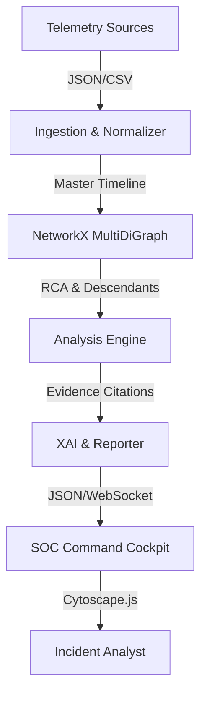

# OBSYRON Architecture — System Architecture

## 1. Overview
OBSYRON provides an end-to-end cyber-forensic investigation platform designed to operate with sub-15ms graph reconstruction latency. It bridges data ingestion, temporal normalization, multigraph correlation, explainable AI, and interactive visualization into a unified, air-gapped system.

## 2. Key Subsystems
1. **Ingestor (`ingestor.py`):** Normalizes diverse enterprise schemas and reconciles host clock drifts.
2. **Graph Engine (`graph_engine.py`):** Builds in-memory multigraph, calculates betweenness centrality, and performs causal graph traversals.
3. **Application API (`app.py`):** Exposes dual-bound REST endpoints with Vercel path normalizer middleware.
4. **Evidence DNA:** Provides cryptographic citation tracking linking each claim to an exact raw event.
5. **Interactive UI (`static/` & `public/`):** Renders the single-viewport SOC command center with Cytoscape.js, time-travel player, and Web Speech audio debrief.
